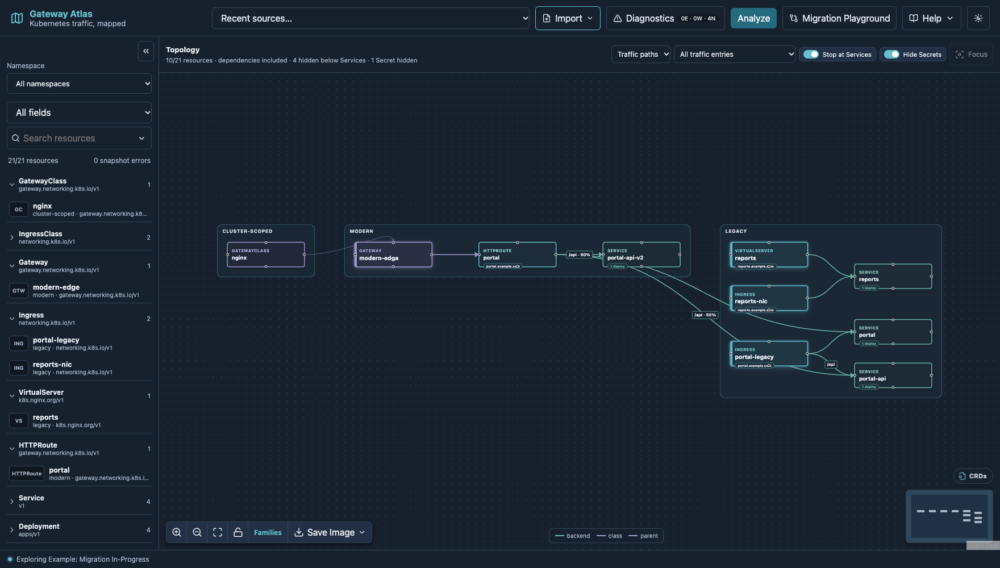
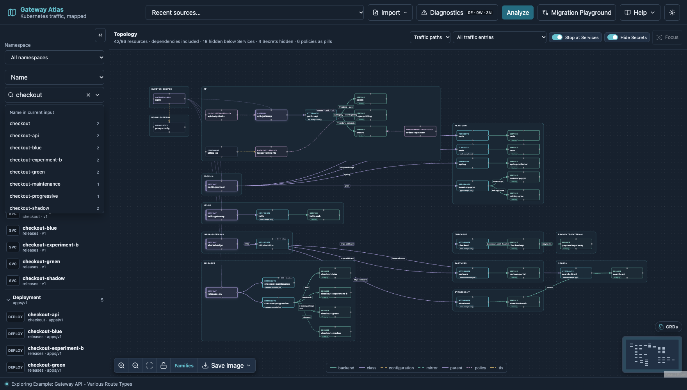
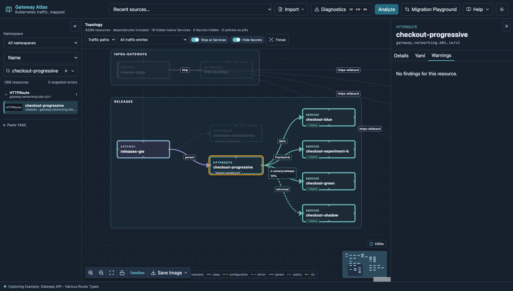
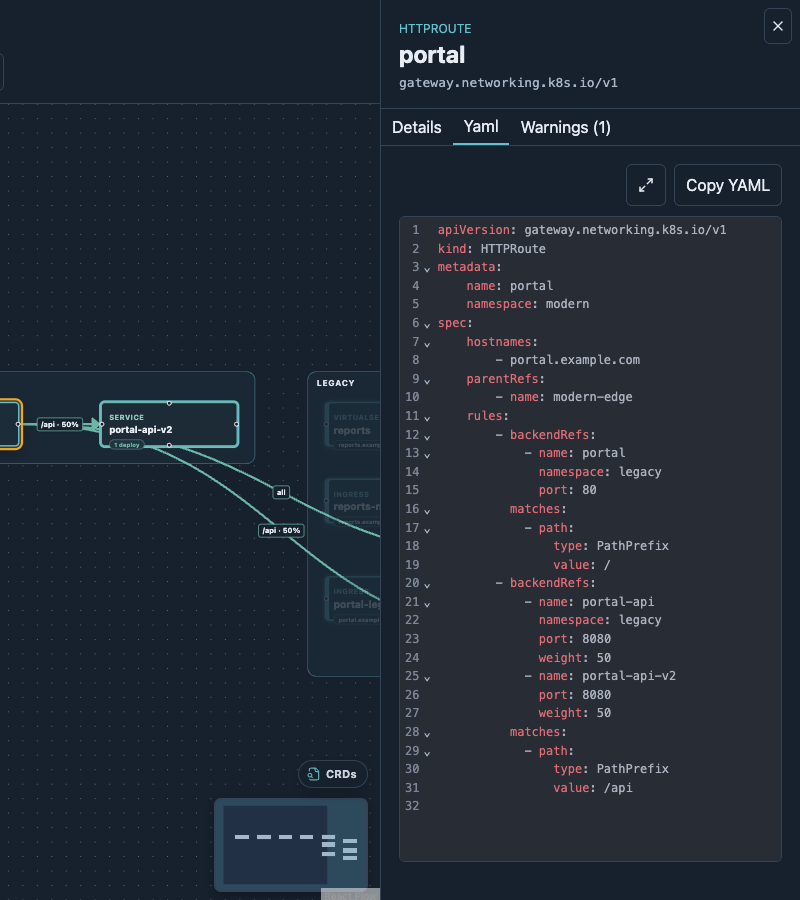
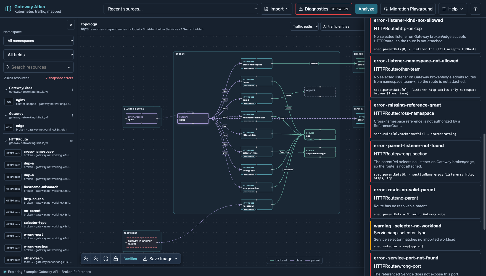
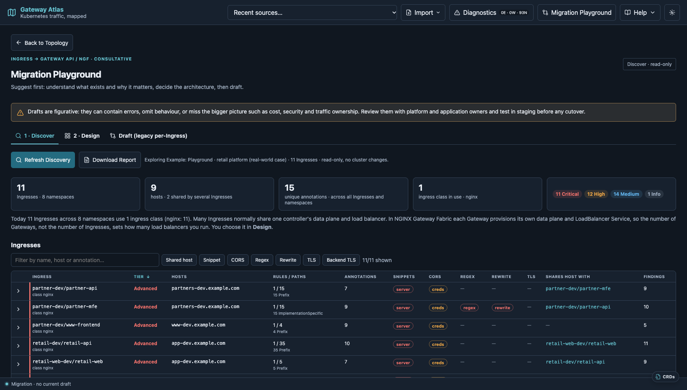
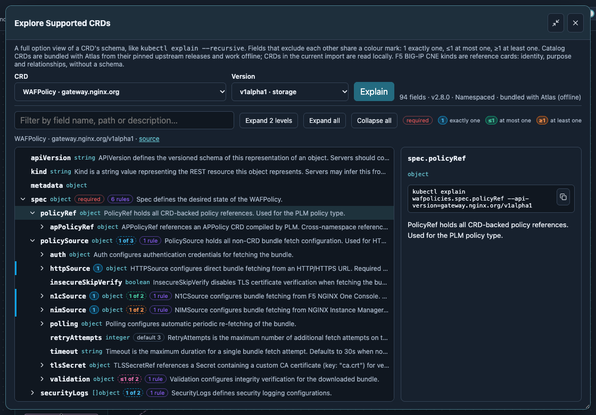
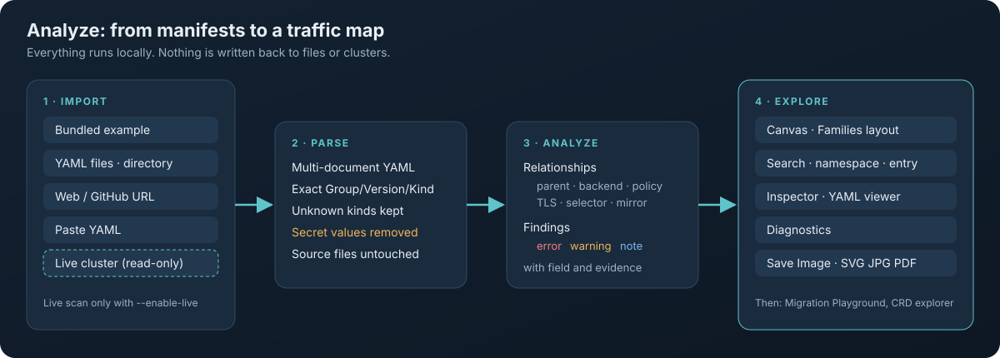
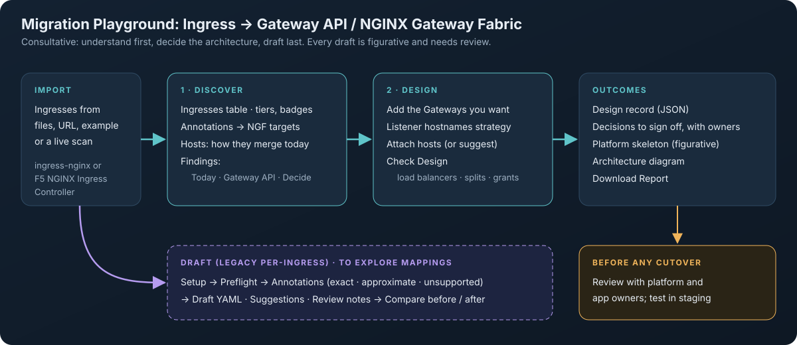

# Gateway Atlas

**Gateway Atlas maps Kubernetes traffic.** Load your manifests, or read a cluster read-only, and see how every Gateway, route, policy, certificate and Service relates to the others. It flags what looks wrong, and helps you plan the move from Ingress to Gateway API and NGINX Gateway Fabric.



This repository is for **Gateway Atlas users**. It has the guides, a few example manifests, and the forms for reporting issues and feedback. Gateway Atlas is in an open **preview**; the current release is **2.3.1**.

**New here?** Read the [Quick start](docs/quick-start.md): you can be exploring in about five minutes.

## Why Gateway Atlas

Kubernetes networking configuration is spread across many objects and API groups. Each one is easy to read, but how they connect is not. Typical questions are hard to answer from YAML alone:

- Which Gateway, listener and route serve this hostname, and which Service do they reach?
- Which policy, filter, certificate or WAF policy applies, and from which namespace?
- What is broken or ambiguous? For example a missing Service, a cross-namespace reference without a ReferenceGrant, or a route that no listener accepts.
- **Migration:** the community `kubernetes/ingress-nginx` controller was retired in March 2026. What does moving these Ingresses to Gateway API involve? How many Gateways, and therefore load balancers, should there be?

Gateway Atlas answers these questions in three ways:
- it builds one relationship graph from your resources;
- it draws the graph on an interactive Canvas;
- it explains its findings in plain language.

## What you can do

| | |
| --- | --- |
|  | **Find anything fast.** Search all fields, or one of Kind, Namespace, Label, API group or Name, with suggestions from your import. Pick a result and the Canvas frames it. |
|  | **See what traffic really does.** Edge labels show paths, weights, header and query matches, mirrors and redirects. Many policies collapse into clickable pills. |
|  | **Inspect and read YAML.** Every card opens an inspector with facts, relationships, findings and the original YAML. |
|  | **Diagnose.** Errors, warnings and notes name the exact field and evidence. Click one to jump to the resource. |
|  | **Plan a migration.** Discover what your Ingresses do, design the Gateways you want, and get decisions, a platform skeleton and an architecture diagram. |
|  | **Explore CRDs offline.** A `kubectl explain`-style tree for the bundled Gateway API, NGINX, F5 WAF and F5 CIS schemas, with mutually exclusive fields marked. |

It covers:
- Kubernetes and Gateway API (including the Inference Extension);
- NGINX Gateway Fabric;
- F5 NGINX Ingress Controller and F5 WAF for NGINX;
- F5 BIG-IP Container Ingress Services and IPAM;
- F5 BIG-IP Next for Kubernetes.

## How it works





## Quick start

You need Docker: Docker Desktop on macOS, or Docker Engine on x86-64 Linux.

```bash
docker run --rm -p 127.0.0.1:8080:8080 ghcr.io/tareqaminul/gateway-atlas:latest serve --addr 0.0.0.0:8080
```

`latest` follows the newest release; pin a version tag such as `:2.3.1` for a fixed setup.

1. Open <http://127.0.0.1:8080>.
2. Choose **Import → Bundled example** and pick any example.

To read a live cluster, see [Quick start · with a live cluster](docs/quick-start.md#4-optional-connect-a-live-cluster-read-only).

## What's new in 2.3.1

- **Save snapshot:** keep a live scan as a YAML file and analyse it offline later, with its scan time and warnings.
- **Load kubeconfig** in the cluster dialog, kept in memory only; clearer live-cluster errors; scan warnings in **Diagnostics**.
- **Inference Extension:** InferencePools read like Services, with the Endpoint Picker beside each pool and shared model servers on one card.
- **Canvas:** class tiles, shared Services and linked namespaces sit next to what they connect; TransportServer heads its row.
- **Secrets:** values are removed from every import, including pasted YAML.
- **BIG-IP Next for Kubernetes 2.x** resources are discovered and linked.

## Design principles

- **Local-first:** it runs on your machine, and your manifests are not sent to any service.
- **Read-only:** live cluster access is opt-in and only lists resources. Atlas has no code to create, update, delete, apply or exec anything.
- **No Secret data:** Kubernetes Secret `data` and `stringData` are removed before analysis, from every source, including pasted YAML; only names and types are shown.
- **Honest about limits:**
  - Static analysis is labelled as static.
  - Approximate or unsupported migration behaviour is reported, never silently dropped.
  - Migration drafts are figurative and must be reviewed.

## Documentation

- [Quick start](docs/quick-start.md): run Atlas, with or without a cluster, and take a five-minute tour.
- [User guide](docs/user-guide.md): every feature, with screenshots. It covers imports, the Canvas, search, the inspector, diagnostics, the Migration Playground, the CRD explorer, the command line and troubleshooting.
- [Examples](examples/): synthetic manifests to import as files.

## Feedback and issues

Please open an issue in this repository using the **Bug report** or **Feedback** form. Include:
- the Atlas release (**Help → About**);
- your browser and platform.

**Never paste kubeconfig credentials, tokens, certificates, Secret values or private manifests into an issue.** Reduce a problem to a small synthetic example instead. To report a security problem privately, see [SECURITY.md](SECURITY.md).

## License

Apache License 2.0. See [LICENSE](LICENSE).
