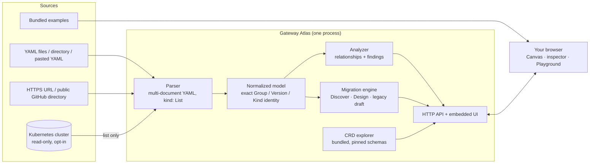

# Gateway Atlas architecture

Gateway Atlas is **one program**: a Go server with the web UI built in, delivered as a single binary or a multi-architecture container image. It needs no database, no cloud service and no agent in your cluster.

## The pieces

| Part | What it does |
| --- | --- |
| **Parser** | Reads multi-document YAML and `kind: List`, keeps the original text of every object, and records where each one came from (file, URL or cluster). Unknown kinds are kept as generic resources, not dropped. |
| **Normalized model** | Identifies every object by its exact API group, version, kind, namespace and name. A kind name alone is never treated as an identity, so `cis.f5.com/VirtualServer` and `k8s.nginx.org/VirtualServer` stay distinct. |
| **Analyzer** | Resolves explicit references into directed relationships: class → Gateway, route → Gateway (parent), route → Service (backend), policy → target, TLS → Secret, Service → workloads by selector, and product-specific links for NGF, NGINX Ingress Controller, App Protect, F5 CIS/IPAM and BIG-IP Next. It produces findings (error, warning, info) with the exact field and evidence. |
| **Migration engine** | Analyzes `networking.k8s.io/v1` Ingresses (Discover), evaluates the Gateway topology you choose (Design), and produces the design outcomes. A legacy per-Ingress converter is still available for reference drafts. |
| **CRD explorer** | Turns pinned upstream CRD schemas into a field tree. The schemas are bundled in the binary and verified with SHA-256 checksums, so it works offline. |
| **HTTP API + UI** | Serves the React UI and a small JSON API on one address, by default `127.0.0.1:8080`. The Canvas (React Flow) lays out the graph by namespace and controller. |

## How an import flows

1. You import YAML, a URL, a GitHub directory, an example, or start a read-only cluster scan.
2. The server parses and normalizes the objects and removes Secret `data` and `stringData`.
3. The analyzer builds relationships and findings and returns them to the browser.
4. The browser draws the Canvas, the resource list, the inspector and the diagnostics. Nothing is written back anywhere.

Analysis is **static**: it describes the configuration you supplied. It does not prove that a controller accepted it, that endpoints are ready, or that traffic flows end to end. A live scan adds observed status conditions, which Atlas shows when they report a problem.

## Migration Playground in brief

- **Discover:** one row per Ingress and per host. It models how ingress-nginx merges Ingresses that share a host (oldest Ingress first, host-wide regex, one effective server snippet), checks Gateway API limits (16 rules per HTTPRoute, 64 listeners per Gateway, 4,096-character header values), and raises coded findings in a *Today / Gateway API / Decide* format.
- **Design:** you define the Gateways; Atlas never picks a topology for you. You attach each host to one or more of them, and Atlas checks the result: load balancers compared with today, listeners, `allowedRoutes`, ReferenceGrants, certificates, route splits and hostname ownership.
- **Outcomes:** a design record (JSON), a decision list with owners, a figurative platform skeleton (Gateways, listeners, namespace labels and ReferenceGrants), and an architecture diagram that stops at Services. HTTPRoutes and policies belong to a later drafting step, because they need decisions the topology alone cannot make.

## Trust boundaries

- **Cluster access is opt-in and read-only.** It is off unless the server starts with `serve --enable-live`. The scanner only lists a fixed set of core, networking and Gateway API resources plus discovered NGINX/F5 API groups, with a 30-second timeout. It handles partial RBAC by reporting what it could not read. It contains no mutation code.
- **Secrets:** values are removed on the server before analysis. The UI only ever sees a Secret's name and type.
- **Kubeconfig** is read by the server process from the location you mount or configure. It is never sent to the browser, logged or stored by Atlas.
- **Outbound network:**
  - **Web / GitHub URL import** fetches what you ask for: one HTTPS document or a public GitHub directory, bounded in size.
  - **CRD explorer:** bundled schemas need no network. A fetch from fixed, pinned `raw.githubusercontent.com` URLs is only a fallback.
  - **Nothing else:** there is no telemetry.
- **Imported manifests are never modified.** Generated migration content is a download, never applied.
- **Browser storage** keeps recent sources, layout preferences and the current design for your browser session or profile only.

## Platforms

One release tag provides `linux/amd64` (x86-64 Linux) and `linux/arm64` (Apple Silicon Docker Desktop). The image runs as a distroless non-root user. Atlas is meant to run next to your tools, for example on a laptop or an OpenShift provisioner host, not inside the cluster it inspects.
