# Gateway Atlas user guide

This guide covers every part of Gateway Atlas 2.3.0. It starts with running Atlas, then explores your configuration on the Canvas, reads a live cluster, plans a migration in the Migration Playground, and explains CRDs. You do not need to know how Atlas works inside. If you only want to get going, start with the [quick start](quick-start.md).

- [1. Run Gateway Atlas](#1-run-gateway-atlas)
- [2. The workspace at a glance](#2-the-workspace-at-a-glance)
- [3. Import options](#3-import-options)
- [4. Connect to a live cluster (read-only)](#4-connect-to-a-live-cluster-read-only)
- [5. The Canvas](#5-the-canvas)
- [6. Search and narrowing down](#6-search-and-narrowing-down)
- [7. Inspector and YAML viewer](#7-inspector-and-yaml-viewer)
- [8. Diagnostics](#8-diagnostics)
- [9. Example gallery](#9-example-gallery)
- [10. Migration Playground](#10-migration-playground)
- [11. Explore Supported CRDs](#11-explore-supported-crds)
- [12. Help, themes and recent sources](#12-help-themes-and-recent-sources)
- [13. Command line](#13-command-line)
- [14. Troubleshooting](#14-troubleshooting)
- [15. Privacy and safety](#15-privacy-and-safety)

## How Atlas works, in two pictures


## 1. Run Gateway Atlas

You need Docker: Docker Desktop on macOS, or Docker Engine on x86-64 Linux. The image is multi-architecture (`linux/arm64` and `linux/amd64`), so Docker picks the right variant automatically.

```bash
docker pull ghcr.io/tareqaminul/gateway-atlas:2.3.0
```

```bash
docker run --rm -p 127.0.0.1:8080:8080 ghcr.io/tareqaminul/gateway-atlas:2.3.0 serve --addr 0.0.0.0:8080
```

Open <http://127.0.0.1:8080>. Stop Atlas with `Ctrl+C` in that terminal.

- **Local only:** `-p 127.0.0.1:8080:8080` publishes the UI on your machine only. Keep the `127.0.0.1` part: Atlas has no login, so do not expose it on a shared network.
- **Another port:** change the first number, for example `-p 127.0.0.1:9090:8080`, and open port 9090.
- **Tags:**
  - `:latest` follows the newest release; a version tag such as `:2.3.0` stays fixed.
  - The older name `ghcr.io/tareqaminul/gateway-atlas-rpi-1` receives the same version tags for existing setups. Despite the name, it is the same image.
- **Version:** **Help → About** shows the running release.

## 2. The workspace at a glance

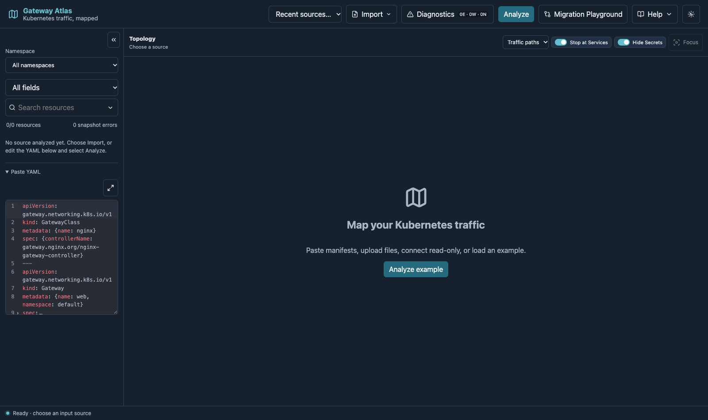

| Area | What it holds |
| --- | --- |
| **Header** | **Recent sources**, **Import**, **Diagnostics** (counts of errors, warnings and notes), **Analyze** (for pasted YAML), **Migration Playground**, **Help**, and the light/dark theme toggle. |
| **Left panel** | **Namespace** filter, **Search**, the resource list grouped by kind, and **Paste YAML**. The **«** button hides the panel. |
| **Topology bar** | A summary of what is shown (for example "16/26 resources · 4 hidden below Services"), the **Topology view**, the **Traffic entry** picker, **Stop at Services**, **Hide Secrets** and **Focus**. |
| **Canvas** | The relationship map, with the toolbar (zoom, fit, lock, layout, **Save Image**), the legend, the minimap and the **CRDs** shortcut. |
| **Inspector** | Opens on the right when you select a resource. |
| **Status bar** | What you are looking at, for example "Exploring Example: Migration In-Progress". |

On an empty start page, **Analyze example** loads a small sample in one click.

## 3. Import options

Open **Import** and choose one of these. The menu closes when you click elsewhere.

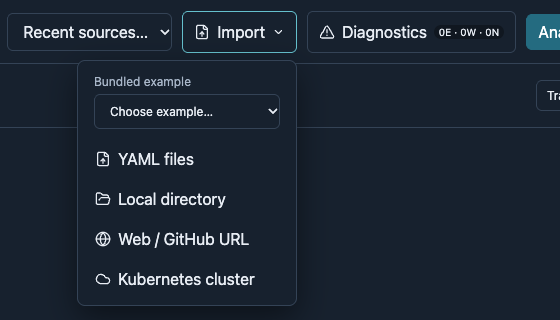

| Option | Use it for |
| --- | --- |
| **Bundled example** | Safe, synthetic samples, grouped into **Scenarios**, **Learning cases**, **Migration Playground** and **BIG-IP Next**. See [section 9](#9-example-gallery) and the quick start's [example table](quick-start.md#6-which-example-should-i-open). |
| **YAML files** | One or more local `.yaml` / `.yml` files. |
| **Local directory** | Every YAML file in a folder tree, for example a Helm-rendered or GitOps directory. |
| **Web / GitHub URL** | An HTTPS YAML document, or a public GitHub directory permalink of the form `https://github.com/<owner>/<repo>/tree/<commit>/<path>`. Pin a commit so the import is reproducible. |
| **Kubernetes cluster** | A read-only scan of a live cluster; see [section 4](#4-connect-to-a-live-cluster-read-only). It is unavailable unless the server was started with `--enable-live`. |

### Paste YAML

Expand **Paste YAML** at the bottom of the left panel and paste one or more documents. Select **Analyze** in the header.
- The editor highlights YAML, numbers lines and folds sections.
- The expand button gives the editor more room.

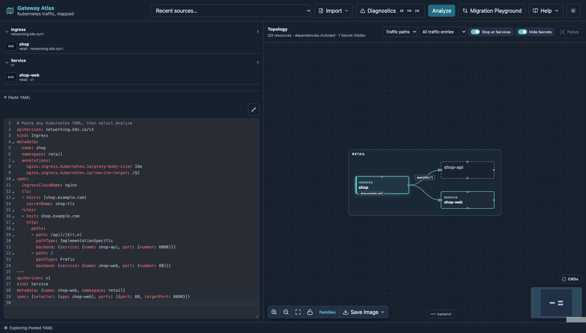

Multi-document YAML and `kind: List` are both supported. Unknown kinds are kept as generic resources. Imported files are analyzed, never modified.

> **Tip:** an Ingress-only or Gateway-only export is normal. A Service that is not in the import is drawn as a dashed placeholder and reported as a note, not as an error. The exception is a live-cluster scan, where the Service should exist.

## 4. Connect to a live cluster (read-only)

Atlas reads a cluster through a kubeconfig on the machine that runs the server, never from the browser. Live access is off until you start the server with `--enable-live`.

### 4.1 Prepare a kubeconfig for the container

Use a dedicated copy, so the container never sees more than it needs. Run these commands as your normal user:

```bash
mkdir -p "$HOME/.config/gateway-atlas" && chmod 700 "$HOME/.config/gateway-atlas"
```

```bash
kubectl config view --raw --flatten > "$HOME/.config/gateway-atlas/config" && chmod 600 "$HOME/.config/gateway-atlas/config"
```

`--flatten` embeds referenced certificate files, so the copy works inside the container. Treat this file as a credential: never commit or share it.

**Docker Desktop's own Kubernetes:** its kubeconfig points at `https://127.0.0.1:6443`, which inside a container means the container itself. Point your copy at the host name Docker provides instead:

```bash
kubectl --kubeconfig "$HOME/.config/gateway-atlas/config" config set-cluster docker-desktop --server=https://kubernetes.docker.internal:6443
```

Clusters reached through a cloud CLI login, such as the AKS, EKS or GKE `exec` plugins, need that CLI inside the container, and the image does not include it. Use a kubeconfig with a static token or client certificate for a read-only service account instead.

### 4.2 Start Atlas with live access

```bash
docker run --rm -p 127.0.0.1:8080:8080 \
  --mount type=bind,source="$HOME/.config/gateway-atlas",target=/home/nonroot/.kube,readonly \
  ghcr.io/tareqaminul/gateway-atlas:2.3.0 serve --addr 0.0.0.0:8080 --enable-live
```

The directory must contain a file named `config`. `--mount` fails clearly if the source is missing, whereas `-v` would silently create an empty directory.

### 4.3 Scan

1. Choose **Import → Kubernetes cluster**.
2. Pick a **Context**. Atlas shows the **Target cluster** it will read.
3. Optionally pick a **Namespace**; the default is **All permitted namespaces**.
4. Select **Scan read-only**.

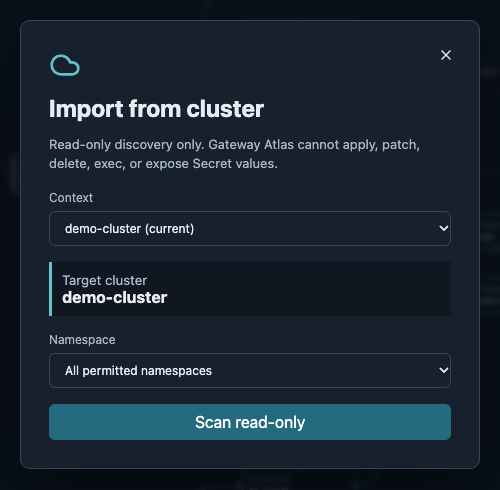

Atlas lists:

- **Core and networking:** Namespaces, Services, EndpointSlices, Pods, Deployments, ConfigMaps, Secrets (metadata only) and Ingresses.
- **Gateway API:** GatewayClasses, Gateways, HTTPRoutes and ReferenceGrants.
- **Discovered API groups:** every installed resource that allows `list` in these groups:
  - NGINX: `k8s.nginx.org`, `gateway.nginx.org`;
  - F5 WAF for NGINX (App Protect): `appprotect.f5.com`;
  - F5 CIS and IPAM: `cis.f5.com`, `fic.f5.com`;
  - BIG-IP Next: `k8s.f5net.com`, `gateway.k8s.f5net.com`;
  - Inference Extension: `inference.networking.k8s.io`, `inference.networking.x-k8s.io`.

Other Gateway API kinds, such as GRPCRoute or TLSRoute, IngressClasses and other workload kinds are not scanned yet; import them as files if you need them. If your RBAC denies something, the scan still completes and reports what it could not read. If the cluster cannot be reached, Atlas says so and offers **Try again**.

**What Atlas never does with a cluster:** create, update, patch, delete, apply, exec or port-forward. A read-only `ClusterRole` with `list` on these resources is enough. Secret values are removed on the server before analysis.

## 5. The Canvas

The Canvas reads **left to right**:

class or controller → traffic entry (Gateway, Ingress, VirtualServer) → routes → Services → workloads

Policies, TLS and configuration sit in nearby lanes, and namespaces are drawn as tiles.

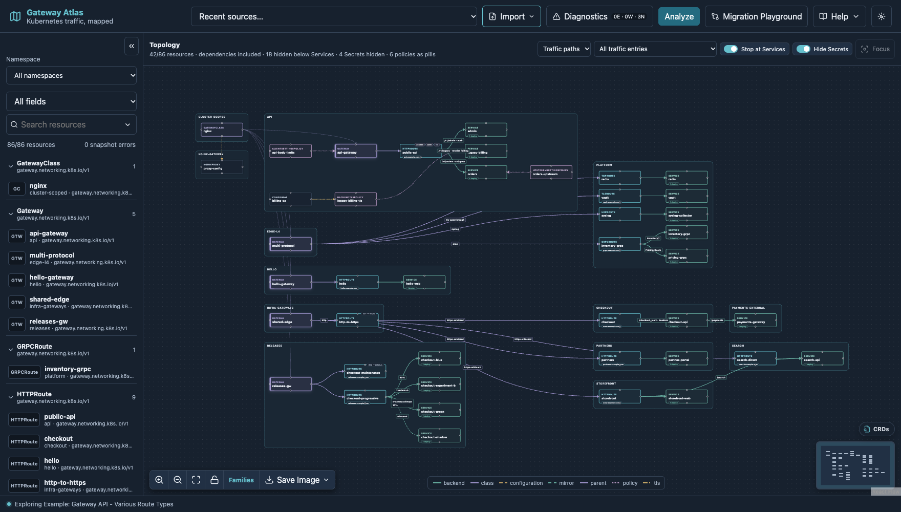

### 5.1 Layouts

The **Families** button in the toolbar switches the layout to **Classic** and back, and your choice is remembered.
- **Families** (default) gives each Gateway family one row, with its policies and configuration, and one band per controller.
- **Classic** is the earlier namespace-tile layout.

Large imports stay readable. When a column would hold more than eight namespaces, Atlas wraps it into a grid shaped like the window.

### 5.2 Reading cards and lines

- **Cards:** each card shows its kind and name. Small badges add facts, such as the hostnames on a route or "1 deploy" on a Service. A dashed card is something that is referenced but not in your import.
- **Lines:** each line points from the resource that declares a reference to its target. The style tells you the type: traffic (parent, backend, selector) is solid, while configuration, policy, TLS and mirror lines have their own dash patterns and colours. The **legend** at the bottom names every type on screen.

**Traffic semantics.** Edge labels show what the traffic does:
- the path;
- weights such as `90%`;
- header, query and method matches such as `x-canary=always`;
- rule filters;
- `mirrored` backends;
- redirects such as `301 → https`;
- Ingress canaries and VirtualServer splits.


**Policy pills.** When more than two policies or filters attach to one resource, they collapse into **pills** above the card. Click the **+N** pill to see them all. Route policies sit in a lane above their route.

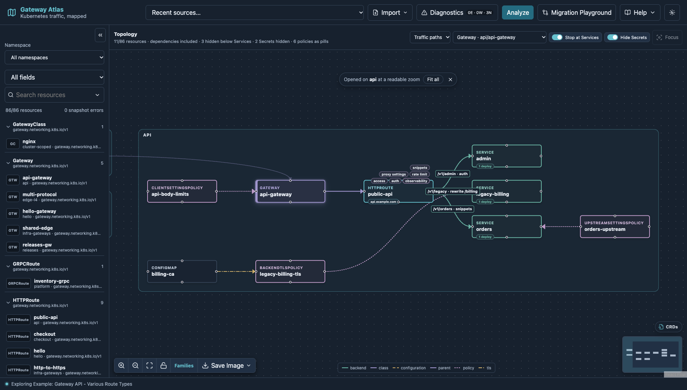

### 5.3 Navigating

- **Zoom:** scroll over the Canvas, or use **Zoom in** and **Zoom out**. **Fit view** shows everything.
- **Opening view:** large imports open at a readable zoom, with a notice such as "Opened on *api* at a readable zoom". Select **Fit all** there to see everything.
- **Drag:** drag a card to move it, or drag a namespace tile to move the whole namespace.
- **Lock graph:** the padlock locks the Canvas, so nothing moves by accident.
- **Minimap:** bottom right.

### 5.4 Narrowing the Canvas

| Control | What it does |
| --- | --- |
| **Topology view** | **Traffic paths** focuses on traffic entries and what they reach; **All resources** shows everything. |
| **Traffic entry** | Follow one Gateway, Ingress, VirtualServer or route, such as `Gateway · api/api-gateway`. |
| **Stop at Services** | Hides Pods, workload controllers and EndpointSlices, and shows their counts on each Service (on by default). |
| **Hide Secrets** | Hides Secret cards and the lines to them. Names and types stay in the list and inspector (on by default). |
| **Focus** / **Show all** | Keeps only the selected resource's neighbourhood, and brings everything back. |
| **Namespace** (left panel) | Limits the view to one namespace. |

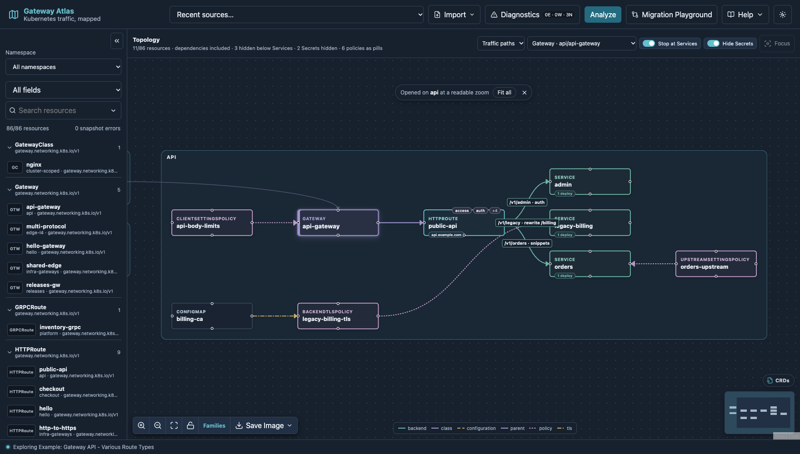

### 5.5 Save Image

**Save Image** exports the whole topology as:
- **SVG:** vector, preferred, lossless;
- **JPG:** a high-resolution picture;
- **PDF:** a vector document.

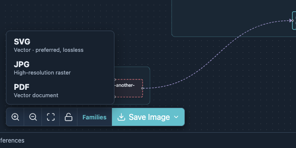

## 6. Search and narrowing down

**Search resources**, in the left panel, searches all text, or one field picked in the drop-down above it:
- **Kind**;
- **Namespace**;
- **Label** (`key` or `key=value`);
- **API group**;
- **Name**.

Suggestions come from your current import and show how many resources match.


As you type, the resource list narrows (for example "1/86 resources"). Click a resource in the list, or pick a suggestion, to select it. The Canvas then moves as little as possible to show the resource with its relationships. Clicking a card near the edge of the Canvas brings its relationships into view in the same way.

Clear the search with **✕**.

## 7. Inspector and YAML viewer

Select any card or list entry to open the **inspector**. You can resize it, or close it with **✕**.

- **Details:**
  - **At a glance:** the key facts, such as hostnames, parent Gateways, rules, backends and status;
  - **Identity:** namespace, source document and API group;
  - **Relationships:** every link in and out, with the field that creates it, for example `spec.rules[0].backendRefs[0]`.
- **Yaml:** the original YAML, with line numbers and folding. The large `kubectl.kubernetes.io/last-applied-configuration` annotation is folded for you. **Copy YAML** copies it; the expand button opens a larger view.
- **Warnings:** this resource's findings, with the field, an explanation and the evidence.

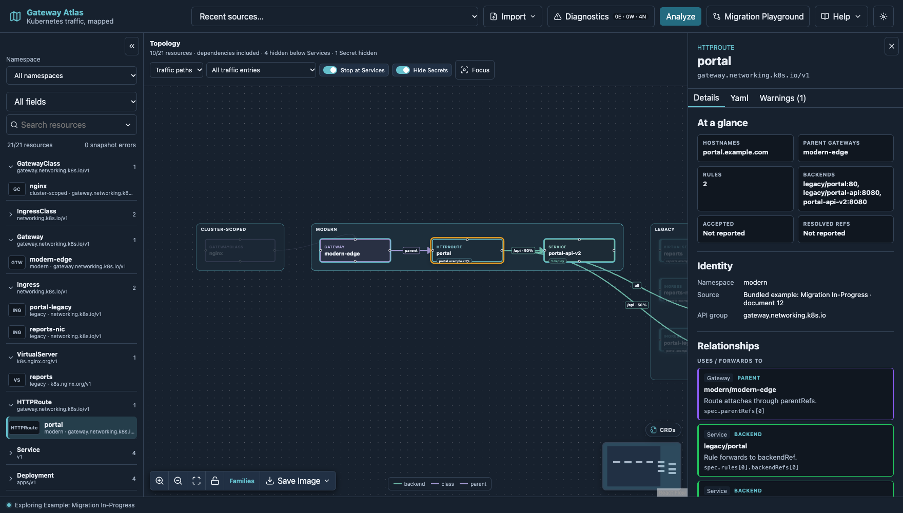


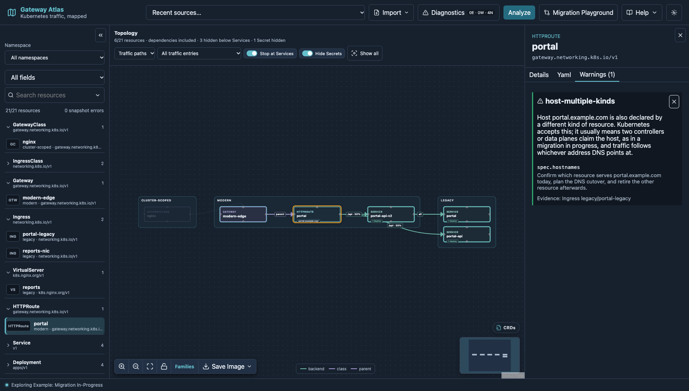

## 8. Diagnostics

**Diagnostics**, in the header, lists every finding, and its badge shows the counts (for example `7E · 1W · 9N`). Click a finding to jump to the resource.

| Severity | Meaning | Examples |
| --- | --- | --- |
| **Error** | Definite under the available evidence. | A route whose `sectionName`, `port`, kind, namespace or hostname matches no listener. A cross-namespace reference without a ReferenceGrant. A Service port that does not exist. |
| **Warning** | Likely; needs review. | A Service selector that matches no imported workload. |
| **Note** | Context, or a limitation of a partial import. | A Service that is not in the files. A hostname shared by several routes, kinds or namespaces. The IngressLink that NGINX Gateway Fabric creates for you. |


Static analysis does not prove controller acceptance, endpoint readiness, DNS or reachability.

## 9. Example gallery

Every bundled example is synthetic and safe to share. A few that show what the Canvas can do:

**NGF · WAF (Policy Source Type - PLM).** F5 WAF for NGINX on NGINX Gateway Fabric, with policies managed by Policy Lifecycle Management. One WAFPolicy protects the Gateway, and a stricter one overrides it on one route.

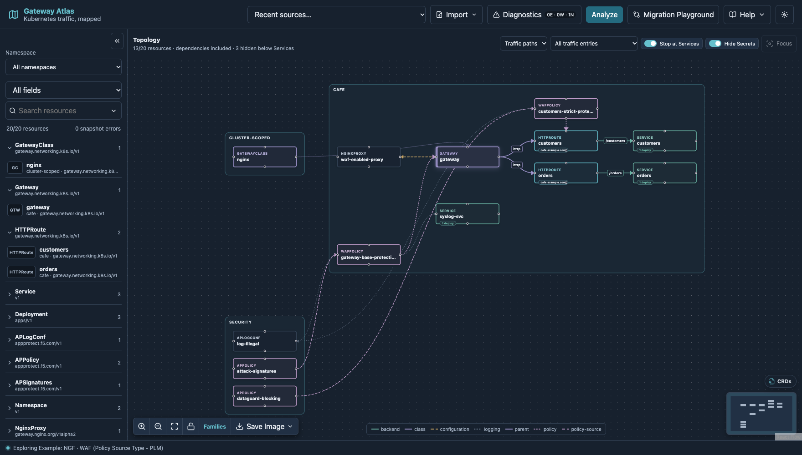

**NGF · AI Guardrails Integration.** An inference Gateway whose PayloadProcessors call an F5 AI Guardrails scanner, with BackendTLSPolicy and CA ConfigMap.

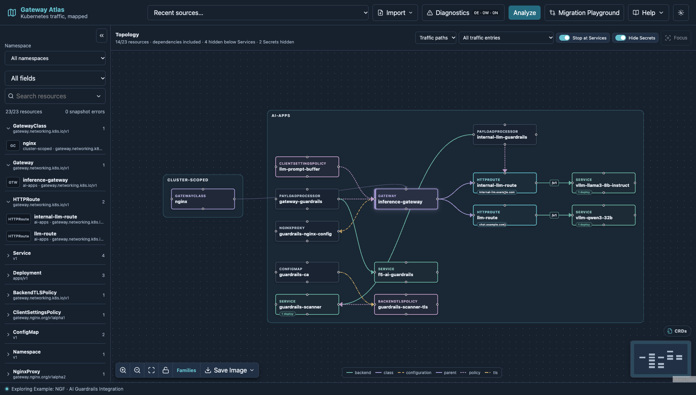

**NGF · External LB Integration (BIG-IP CIS, IPAM, GatewayLink).** BIG-IP in front of NGF:
- NGF creates the IngressLink for each Gateway itself, linked through its owner reference;
- F5 IPAM assigns the addresses.

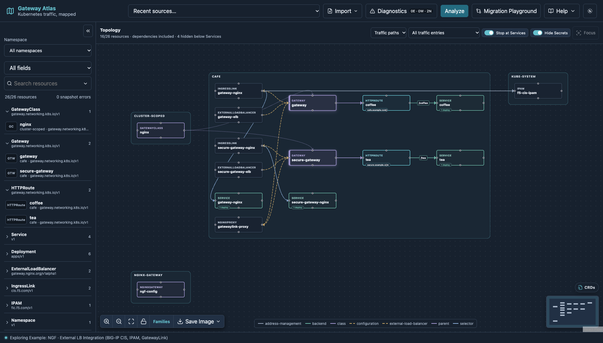

**BIG-IP Next · BNK beside Envoy (data-plane comparison).** BIG-IP Next for Kubernetes and Envoy Gateway side by side, including AI-safety and LLM routing.

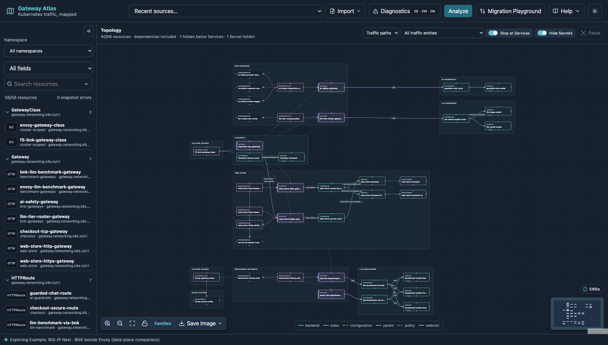

**Gateway API Inference Extension · Endpoint Picker and vLLM**, shown here in the light theme. InferencePools with Endpoint Pickers route model traffic to vLLM servers.

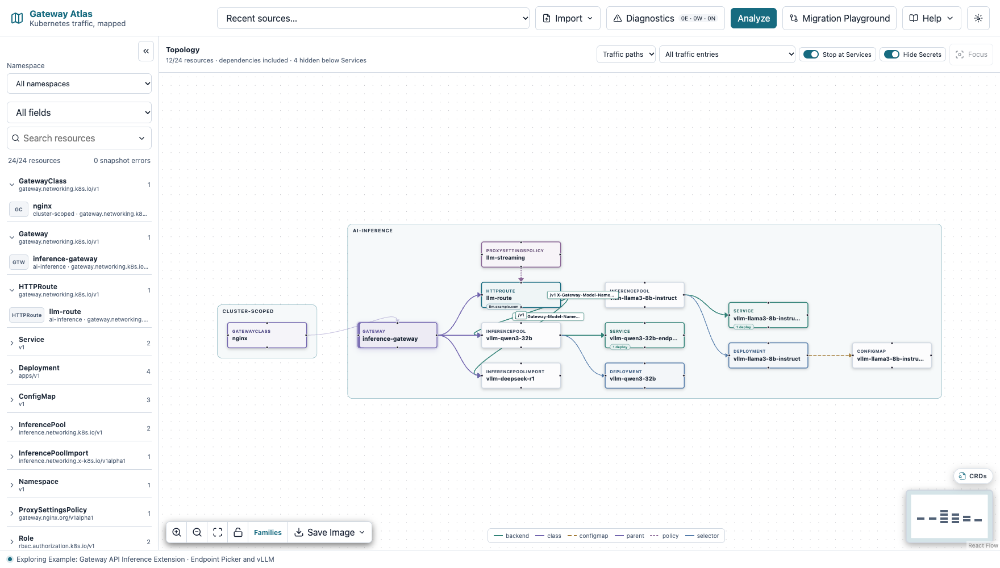

## 10. Migration Playground

The Migration Playground helps you plan a move from **ingress-nginx** or **F5 NGINX Ingress Controller** Ingresses to **Gateway API / NGINX Gateway Fabric**. It is consultative: it explains first and drafts last.

Every draft is **figurative**. It can contain errors, omit behaviour, or miss the bigger picture (cost, security, traffic ownership). Review it with platform and application owners, and test it in staging. A banner reminds you, and copying or downloading a draft asks you to acknowledge this once per session.

To start:
1. Import your Ingresses (files, directory, URL or a live scan).
2. Select **Migration Playground**. It uses every `networking.k8s.io/v1` Ingress in the current import.
3. **Back to Topology** returns to the Canvas.

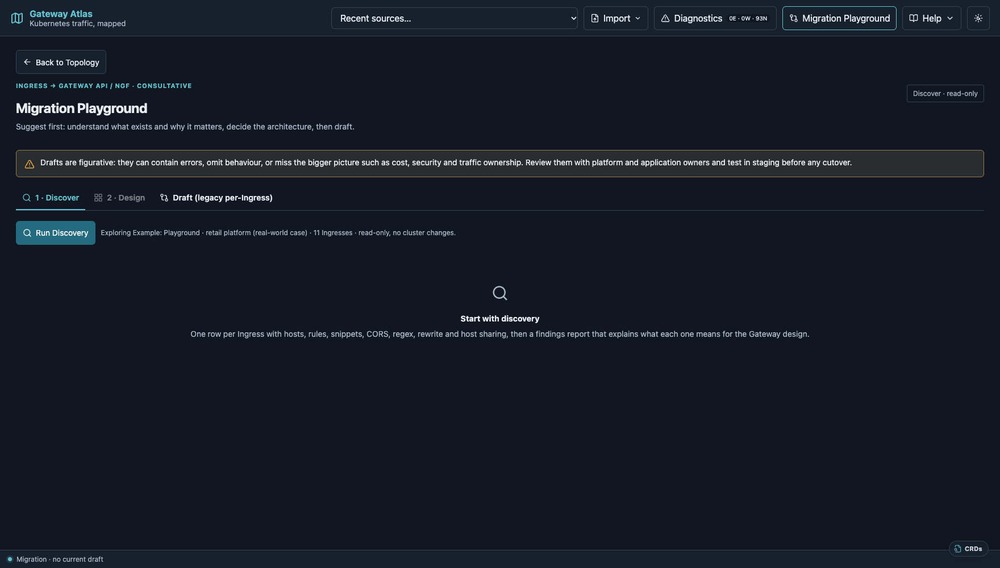

### 10.1 Discover

Select **Run Discovery**. **Download Report** saves everything below as one report.

**Summary.** The summary counts:
- Ingresses and namespaces;
- hosts, and how many are shared;
- **unique annotations**;
- ingress classes;
- findings by severity (Critical, High, Medium, Info).

Many Ingresses normally share one controller's data plane and load balancer. In NGINX Gateway Fabric, **each Gateway gets its own data plane and LoadBalancer Service**, so the number of Gateways, not Ingresses, sets the number of load balancers.


**Ingresses table.** There is one row per Ingress, with:
- its tier (Simple / Moderate / Advanced);
- hosts, rules and paths;
- annotations;
- snippets, CORS, regex, rewrite and TLS;
- which Ingresses it shares a host with.

Sort by any column, filter by text, or use the badges: **Shared host**, **Snippet**, **CORS**, **Regex**, **Rewrite**, **TLS** and **Backend TLS**.

Expand a row to see its settings and its parsed snippet: the headers it adds, with their lengths, the headers it hides, and any conditional logic.

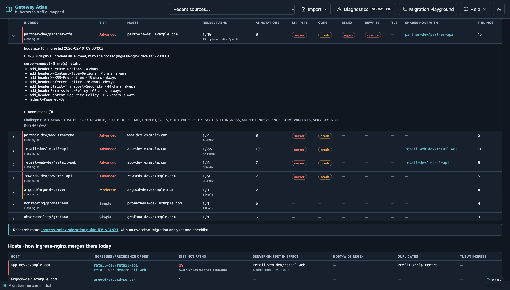

Open **Annotations** in an expanded row. Each annotation gets:
- an outcome, such as *close equivalent* or *not mapped — decide manually*;
- a note.

Where Atlas knows the target, a chip such as **HTTPRoute** `spec.rules.filters.cors` opens that exact field in the CRD explorer.

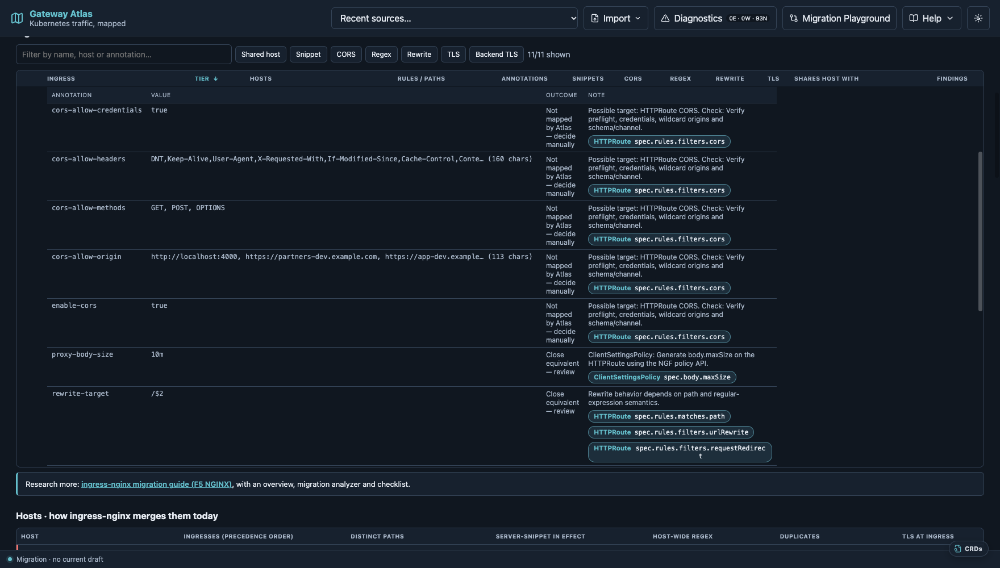

**Hosts table.** It shows how ingress-nginx merges Ingresses that share a host today:
- the contributors, in precedence order (oldest first);
- distinct paths, checked against the 16-rule HTTPRoute limit;
- which `server-snippet` is actually in effect;
- host-wide regex and duplicate paths.

**Findings.** Findings are grouped by severity. Each one says:
- what happens **today**;
- what **Gateway API / NGF** offers;
- what you need to **decide**, with the resources and evidence.

Click a resource name to jump to its row.

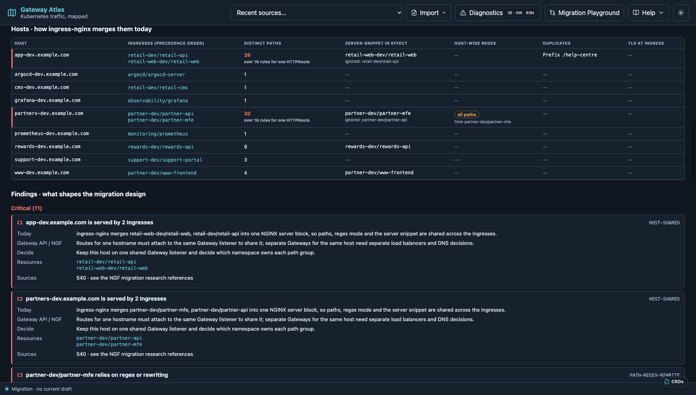

**Research more** links to the F5 NGINX ingress-nginx migration guide. External links always ask before opening a new tab.

### 10.2 Design

Open **2 · Design**. Atlas does **not** preselect a topology.

1. **Add Gateway** for each Gateway you intend to run. Give it:
   - a **name** and **namespace**. `default` is fine, but a dedicated namespace such as `gateway-infra` keeps Gateways, RBAC and certificates apart from applications;
   - optionally, a **purpose** (for example *external* or *internal*);
   - the **GatewayClass** of your NGF installation.
2. Choose **Listener hostnames** for each Gateway:
   - **Per host:** an exact listener per host. This is strict, but you must edit the Gateway for every new host, and each host counts towards the 64-listener limit.
   - **Wildcard:** listeners such as `*.example.com`. They cover deeper subdomains but not the apex. Atlas suggests wildcards after a check, and hosts outside them get exact listeners.
   - **No hostname (on HTTPRoutes):** hostnames live only on the HTTPRoutes. This is the simplest option, but any namespace the Gateway admits can claim any hostname.
3. **Attach hosts:** tick the Gateways each host uses.
   - A host may sit on several Gateways, for example internal and external, or old and new during a cutover.
   - **Suggest by namespace** proposes a Gateway for each host, and **Apply N suggestions** accepts them.
   - **attach all** puts every host on one Gateway.
   - The **Route namespace** column decides where each host's routes live.
   - Expand a host to move an individual Ingress elsewhere.
4. Select **Check Design**.

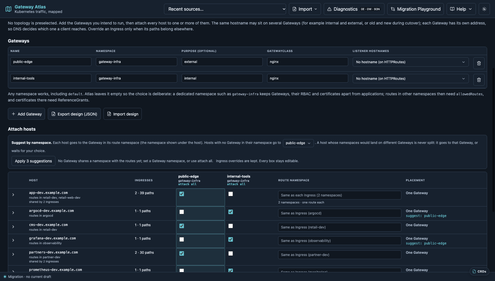

The **design check** shows:
- the Gateway and load-balancer count, compared with today;
- hosts attached, HTTPRoutes after splits, listeners and ReferenceGrants;
- a card per Gateway, with its listeners, `allowedRoutes` and routes;
- design findings, for example routes that need splitting, hostname ownership or cross-namespace admission.

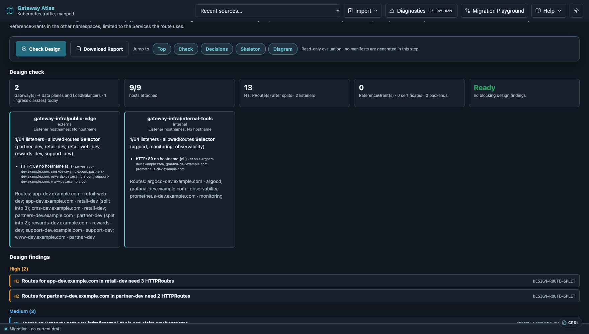

Design produces four outcomes, all included in **Download Report**:

- **Design record:** **Export design (JSON)** and **Import design** let you keep the design in a pull request or ticket, and reload it later.
- **Decisions to sign off:** what Atlas cannot decide for you, each with a suggested owner. Examples are route splits, hostname ownership, namespace admission labels and the load-balancer count.

  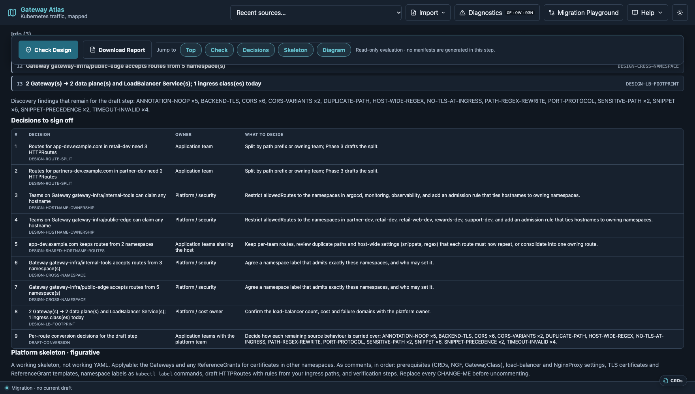

- **Platform skeleton:** figurative YAML for the Gateways and any ReferenceGrants that the design fully determines. Everything else is commented, in order: prerequisites, load-balancer and NginxProxy settings, certificates, namespace labels, draft HTTPRoutes and verification steps. Tick the acknowledgement, then **Download platform skeleton**, **Copy skeleton** or **Open full screen**. Replace every `CHANGE-ME` before uncommenting.

  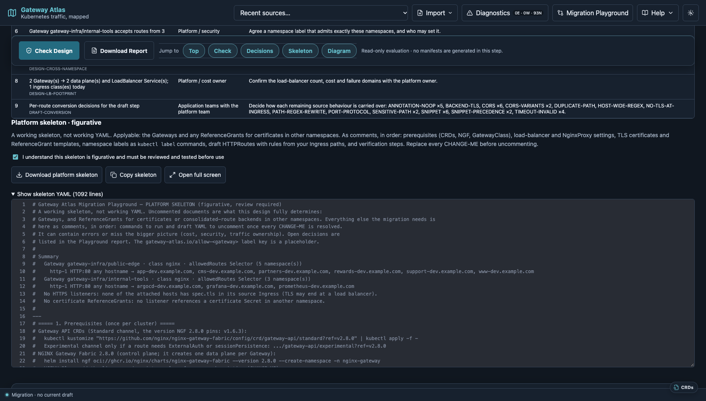

- **Architecture diagram:** draws the design down to Services, with GatewayClass and certificates shown as pills on the Gateway cards.
  - Scroll over the diagram to zoom, or scroll above it to move the page.
  - **Open full screen** gives it the whole window; **Esc** returns.

  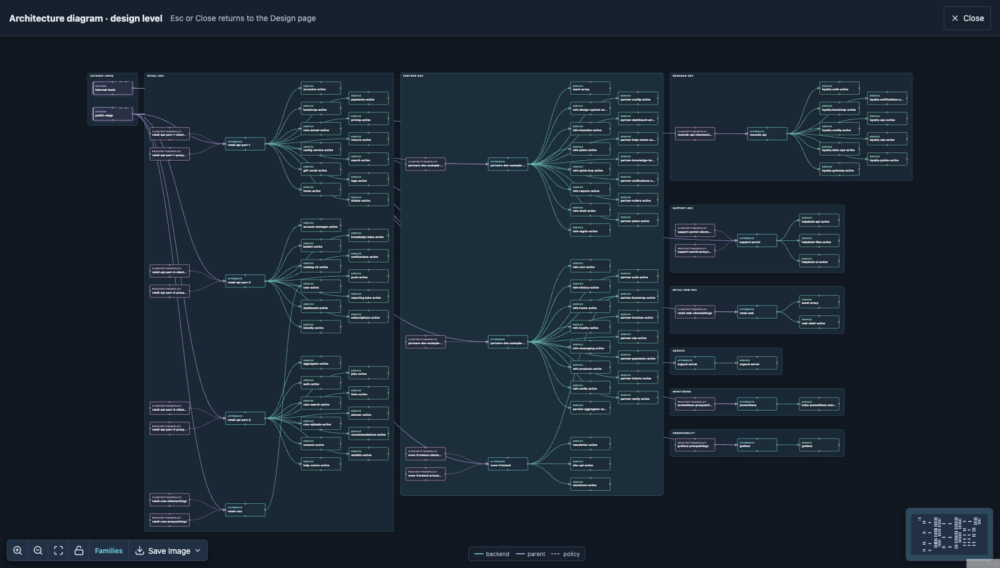

The sticky bar keeps **Check Design**, **Download Report** and the **Jump to** links (Top, Check, Decisions, Skeleton, Diagram) in reach.

### 10.3 Draft (legacy per-Ingress)

The legacy converter maps each Ingress to its own Gateway and HTTPRoutes, without a topology decision. Use it to explore mappings, not as a migration design. It understands both community ingress-nginx and **F5 NGINX Ingress Controller** annotations.

1. **Setup.**
   - **Source snapshot:** the Ingresses in the current import.
   - **Target:**
     - the profile: **NGF v2.8.0 · reviewed policy APIs**, or **Gateway API only · no NGF policies**;
     - the data plane: **NGINX Open Source** or **NGINX Plus**;
     - the **GatewayClass** name.
2. Select **Assess Migration**, or **Assess & Generate Draft**. Generation always includes the assessment.
3. **Migration preflight:**
   - the detected source controller, with its evidence;
   - Ingress and annotation counts;
   - how many Gateways the draft would create;
   - routes over 16 rules.

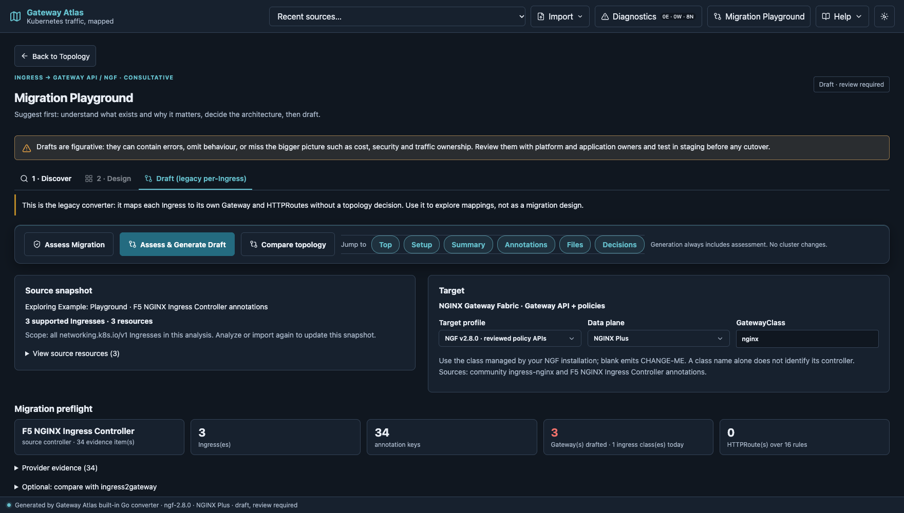

**Annotations.** There is one row per annotation key, with:
- the provider (for example **F5 NIC**);
- the NGF target, with field chips that open the CRD explorer;
- the mapping: **exact**, **approximate** or **unsupported**;
- the edition it needs (for example *NGINX Plus + F5 WAF*);
- the draft result and guidance.

Filter by **Outcome** and **Mapping**, or find a key.
- **Exact** mappings are generated into the draft.
- **Approximate** ones become commented suggestions.
- **Unsupported** ones are reported; nothing is silently dropped.

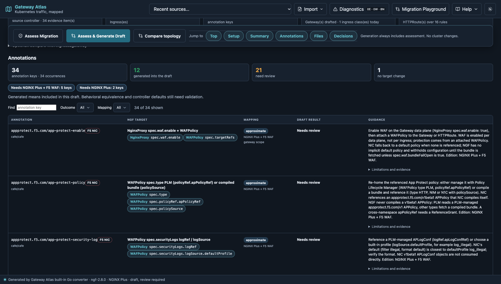

**Files.** The source manifests sit beside the generated output, at equal height. The output has three tabs:
- **Draft YAML;**
- **Suggestions:** commented CHANGE-ME skeletons;
- **Review notes.**

After the acknowledgement you can **Copy Generated YAML**, **Download Draft YAML**, **Download Suggestions** or **Download Review Report**. **Decisions before cutover** lists what still needs an owner.

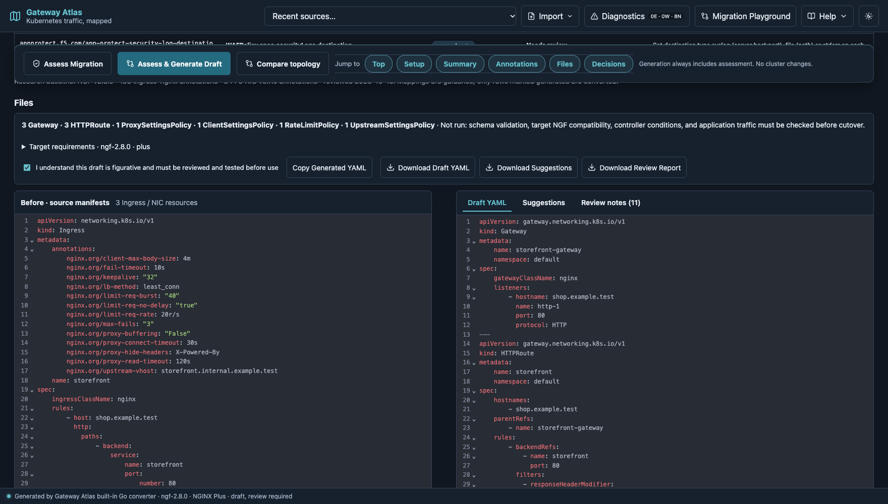

**Compare topology** draws the source snapshot and the proposed draft side by side, on two Canvases. A connected graph does not prove equivalent behaviour or a healthy deployment.

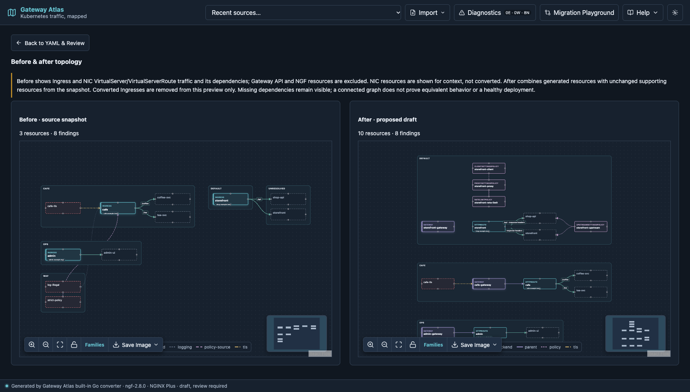

A topology-aware generator, which drafts from your Design record, is planned.

## 11. Explore Supported CRDs

Open **Help → Explore Supported CRDs**, or select the floating **CRDs** button at the bottom right. A window opens and stays open while you work:
- move it by its title bar;
- resize it from the corner;
- minimise it;
- close it with **✕**.

1. **CRD:** choose a CRD, grouped by product and pinned release. CRDs in your current import appear first. The catalog includes:
   - Gateway API Standard and Experimental;
   - NGINX Gateway Fabric 2.8.0;
   - NGINX Ingress Controller 5.7.0;
   - F5 WAF for NGINX, including Policy Lifecycle Management;
   - the Inference Extension;
   - F5 CIS and F5 IPAM;
   - common prerequisites such as cert-manager.
2. **Version:** the storage version is preselected; deprecated versions are marked.
3. **Explain:** shows the full field tree, like `kubectl explain --recursive`.

Each field shows its type, whether it is **required**, enum values, defaults and validation **rules**. Fields that exclude each other share a colour mark:
- **1:** exactly one;
- **≤1:** at most one;
- **≥1:** at least one.


Filter by name, path or description, or use **Expand 2 levels**, **Expand all** and **Collapse all**. Select a field to see its full description, its constraints and a copyable `kubectl explain` command. The **source** link shows where the schema came from.

The catalog schemas are bundled with Atlas, so this works offline. F5 BIG-IP Cloud-Native Edition 2.4 kinds appear as **reference cards** (identity, purpose and relationships), because their schemas cannot be redistributed.

## 12. Help, themes and recent sources

- **Help:**
  - **GitHub repository**;
  - **Explore Supported CRDs**;
  - **About**, which shows the release and the CRD and API versions Atlas knows.
- **Theme:** the sun/moon button switches between light and dark.
- **Recent sources:** reloads an example, file set, URL or scan you used in this browser.

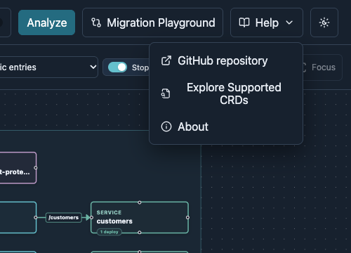

## 13. Command line

The same binary has a command-line interface. With the container, mount your files read-only:

```bash
docker run --rm -v "$PWD:/work:ro" ghcr.io/tareqaminul/gateway-atlas:2.3.0 validate /work/examples/missing-service.yaml
```

| Command | Purpose |
| --- | --- |
| `analyze <files>` | Resources, relationships and findings (`--json` for JSON). |
| `validate <files>` | Findings only; exits non-zero on errors (useful in CI). |
| `explain <files>` | Static traffic paths, with field provenance. |
| `graph <files>` | The relationship graph (`--format json`). |
| `assess <files>` | Migration preflight assessment. |
| `migrate <files>` | Legacy per-Ingress draft into `--output` (default `generated`). |
| `cluster scan --context NAME [--namespace NAME]` | Read-only scan from a kubeconfig (`--kubeconfig`, `--json`). |
| `serve [--addr ADDR] [--enable-live]` | The web UI. |

## 14. Troubleshooting

| Symptom | What to do |
| --- | --- |
| The page does not load | Check that the container is running, and that the port in the URL matches the first number in `-p`. |
| **Kubernetes cluster** is unavailable | Restart with `--enable-live` and a mounted kubeconfig ([section 4](#4-connect-to-a-live-cluster-read-only)). |
| No contexts, or a kubeconfig error | The mounted folder must contain a regular, readable file named `config` at `/home/nonroot/.kube`. Recreate the container after changing the mount. |
| "The cluster could not be reached" | Check network access and credentials. On Docker Desktop, point the copy at `kubernetes.docker.internal:6443` ([section 4.1](#41-prepare-a-kubeconfig-for-the-container)). |
| Cloud cluster authentication fails | `exec` credential plugins are not in the image. Use a static token or certificate for a read-only service account. |
| A relationship line is missing | Check that the source really contains an explicit reference with the exact group, kind, namespace and name. Atlas does not invent links. |
| A card is dashed | It is referenced but not in your import. Import the target too, or check its exact API group, version, kind, namespace and name. |
| The Canvas looks crowded | Use **Stop at Services**, **Traffic paths**, one **Traffic entry**, one namespace, **Search** or **Focus**, then **Fit view**. |
| An external link did nothing | Atlas asks before opening a new tab. If your browser blocks new tabs, use **Copy link**. |

## 15. Privacy and safety

Atlas runs locally and sends your manifests nowhere.

Before you share screenshots, reports, design records or exported YAML, review them for:
- private names and hosts;
- IP addresses;
- annotations;
- internal URLs.

**Never** include kubeconfig credentials, tokens, certificates or Secret values in issues or reports. Reduce problems to small synthetic examples, like the ones in [examples](../examples/).
